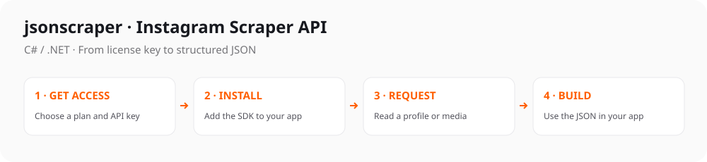

# Instagram Scraper API for C# / .NET

[](https://github.com/jsonscraper/instagram-api-dotnet/tags)
[](#quick-start)
[](https://github.com/jsonscraper/instagram-api-dotnet/commits)
[](LICENSE)

[](https://www.postman.com/jsonscraper/workspace/jsonscraper/collection/52903714-fe84d353-0a19-431f-a39d-1c2640d96fb0)

A small, configurable client with named methods and ready-to-run examples. Supports **97 Instagram Scraper API methods**.

**Package:** `JsonScraper.InstagramApi` · **[Methods](#main-methods)** · **[Examples](#ready-to-run-examples)** · **[Documentation](docs/guide.md)**

<picture>
  <source media="(max-width: 640px) and (prefers-color-scheme: dark)" srcset="docs/quickstart-mobile-dark.svg">
  <source media="(max-width: 640px)" srcset="docs/quickstart-mobile.svg">
  <source media="(prefers-color-scheme: dark)" srcset="docs/quickstart-dark.svg">
  
</picture>

## Quick start

**1. Get your key** from the [Instagram API product page](https://jsonscraper.com/services/ig-scraper-api?utm_source=github&utm_medium=sdk&utm_campaign=instagram-api-dotnet&utm_content=readme) and set it on your server:

```sh
export JSONSCRAPER_INSTAGRAM_LICENSE_KEY='your-license-key'
```

**2. Install the package:**

```sh
git clone https://github.com/jsonscraper/instagram-api-dotnet.git
cd instagram-api-dotnet
dotnet pack -c Release -o ./artifacts
# In your application, use this local package folder:
dotnet add package JsonScraper.InstagramApi --version 0.1.1 --source /absolute/path/to/instagram-api-dotnet/artifacts
```

**3. Make a request:**

```csharp
using JsonScraper.InstagramApi;

using var client = new Instagram(Environment.GetEnvironmentVariable("JSONSCRAPER_INSTAGRAM_LICENSE_KEY")!);
using var response = await client.JsonAsync("/v1/user/by/username", new Dictionary<string, object?> { ["username"]="apple", ["cache_timeout"]=60 });
if (response.RootElement.GetProperty("status").GetString() != "ok") throw new Exception("API application error");
Console.WriteLine(response.RootElement.GetProperty("ig"));
```

The API payload is in `ig`. Live calls require a valid API license and may consume quota. [Response examples and status handling](docs/responses.md).

## Main methods

97 methods are available. Common starting points:

| What you need | Method |
| --- | --- |
| Read a profile | `V1UserByUsernameAsync()` |
| Read a profile by ID | `V1UserByIdAsync()` |
| List profile posts | `V1UserMediasChunkAsync()` |
| Read a post or reel | `V1MediaByCodeAsync()` |
| Read comments | `V1MediaCommentsChunkAsync()` |
| Search profiles | `V1SearchUsersAsync()` |

[All methods and parameters →](docs/endpoints.md)

## Ready-to-run examples

- [Read a profile](examples/endpoints/v1_user_by_username/Program.cs).
- [Read a post or reel](examples/endpoints/v1_media_by_code/Program.cs).
- [Read comments](examples/endpoints/v1_media_comments_chunk/Program.cs).
- [Search users](examples/endpoints/v1_search_users/Program.cs).
- [List profile posts](examples/endpoints/v1_user_medias_chunk/Program.cs).

Each example includes command-line parameters, key setup, timeouts, error handling and response output. Run it with `--help` first; this makes no API request.

**[Browse all 97 complete examples](examples/README.md)** · **[Full method and parameter reference](docs/endpoints.md)**

## Configuration

Requests use a 30-second timeout by default. Configure caching and retries to fit your application's request budget. Keys are read from your server environment; redirects are disabled.

[Configuration options, HTTP errors, caching and pagination](docs/configuration.md) · [Full integration guide](docs/guide.md)

## Use with ChatGPT and Codex

Prefer an assistant connection? Use the separate [Instagram MCP server](https://jsonscraper.com/mcp/instagram?utm_source=github&utm_medium=sdk&utm_campaign=instagram-api-dotnet&utm_content=mcp). It accepts the same product API license and uses the normal API quota. [MCP source and setup](https://github.com/jsonscraper/instagram-mcp-server).

## Access, pricing and support

The SDK source is **MIT-licensed**. Hosted API access requires a separate Instagram license. Check [current plans and get access](https://jsonscraper.com/services/ig-scraper-api?utm_source=github&utm_medium=sdk&utm_campaign=instagram-api-dotnet&utm_content=readme).

[Service support](https://jsonscraper.com/contacts?utm_source=github&utm_medium=sdk&utm_campaign=instagram-api-dotnet&utm_content=support) · [SDK issues](https://github.com/jsonscraper/instagram-api-dotnet/issues) · [Changelog](CHANGELOG.md) · [MIT license](LICENSE)

## Development

```sh
python3 tests/contract.py
```

Tests use a local/mock server and require no API key. A [GitHub Actions template](docs/github-actions.yml) is available for optional automation.

The SDK has no installation or usage telemetry. README links use campaign parameters for website referral analytics. jsonscraper is independent and is not affiliated with Instagram or Meta.
